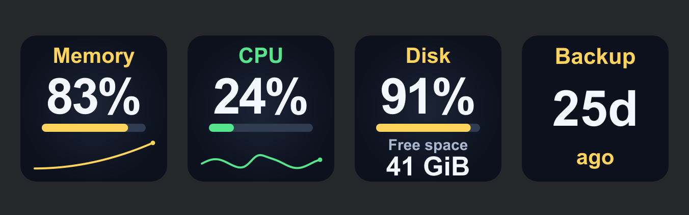

# Mac Health

Four separate Stream Deck keys for macOS: **Memory**, **CPU**, **Disk**, and **Backup**. Add any combination; there is no combined dashboard action.



The keys help you notice resource pressure while working with many applications. They monitor your Mac locally; they do not quit apps, clear memory, change system settings, or predict every crash or freeze.

## What each key means

| Key | Large number and bar | Status color | Bottom line |
| --- | --- | --- | --- |
| Memory | Estimated physical RAM used | macOS coarse memory-pressure level | Schematic 5-minute swap trend |
| CPU | Average total CPU usage over up to 10 seconds | Configurable CPU thresholds | Schematic 5-minute load trend |
| Disk | Used startup data-volume capacity | Configurable available-space thresholds | Available space in GiB |
| Backup | Time since last known completed Time Machine backup | Age: green <7d, yellow 7–29d, red ≥30d | ago |

Status words are hidden on keys: the title and bar use fixed green (normal), yellow (warning), and red (critical). Memory and CPU use the lower area for schematic rolling 5-minute graphs, without axes, scales, legends, or extra numbers. Disk retains its large available-space amount. Status text remains in action settings; unavailable readings stay explicitly marked. Each action has its own thresholds where applicable. All visible actions share one small native sampler, which reads system counters every **2 seconds**. Sampling stops when no Mac Health action is visible. Press Memory or CPU to open Activity Monitor; press Disk to open Disk Utility.

### Memory

The percentage estimates physical memory used by anonymous pages, wired pages, and the physical compressor, subtracting purgeable anonymous pages. Reclaimable file cache is excluded. This is an estimate and may differ from Activity Monitor's Memory Used figure.

Color follows the system's coarse pressure level: **Normal** (green), **Warning** (yellow), or **Critical** (red). It is not a reproduction of Activity Monitor's pressure graph. A large swap allocation alone does not make the key red: swap can remain allocated after a busy period. The Memory line shows swap allocation over the most recent 5 minutes: a flat line means stable allocation; a rising line means increasing allocation. It does not measure swap I/O activity. The vertical range adapts to observed values with a minimum span of 256 MiB, so the trace shows relative direction, not absolute severity. Compressed memory, RAM capacity, swap, and the raw pressure level are shown in the settings panel.

Apple explains why memory pressure is more useful than treating occupied RAM as a problem: [Check if your Mac needs more RAM](https://support.apple.com/guide/activity-monitor/actmntr34865/mac).

### CPU

CPU usage is calculated from changes in system-wide Mach CPU ticks. **100% means the entire logical CPU capacity is busy**, unlike Activity Monitor's per-process percentages, which can exceed 100%. The main number smooths up to five 2-second samples. The lower trace shows raw 2-second load samples over the most recent 5 minutes, with a fixed 0–100% vertical range and no printed scale. The averaging window is shown only in settings; after a long sampling gap it starts a new window.

Defaults: **Warning at 80%**, **Critical at 95%**. Brief spikes are averaged; color also incorporates the system thermal state reported by Apple’s `NSProcessInfo.thermalState` API: fair is yellow, serious/critical are red. This describes overall device thermal conditions, not a Celsius temperature or a direct CPU-only sensor measurement. Missing thermal data does not overwrite a valid load reading; its absence is disclosed in settings. See [Apple’s thermal-state guide](https://developer.apple.com/library/archive/documentation/Performance/Conceptual/power_efficiency_guidelines_osx/RespondToThermalStateChanges.html).

### Disk

Disk reads available capacity on `/System/Volumes/Data`. Defaults:

- Warning: **10% or less free**, or **20 GiB or less available**.
- Critical: **5% or less free**, or **10 GiB or less available**.

Either condition triggers the corresponding status. APFS volumes share container space, so usage may differ from a Finder storage breakdown. Purgeable storage is not treated as immediately available. This key monitors space, not disk activity, SMART data, or SSD wear.

### Backup

Shows the age of the latest known completed Time Machine backup across configured destinations. Below one day it uses hours (`12h`, or `<1h`); from 1–59 days it uses days (`25d`); from 60 days it uses approximate 30-day months (`2mo`). The footer says **ago**. Green means under 7 days, yellow 7–29 days, and red 30+ days. These age thresholds are fixed reminders, not a backup-integrity assessment. Settings show the exact local completion date and metadata check time.

The native helper reads only `Destinations[].SnapshotDates` through macOS CFPreferences every minute. This local Time Machine metadata can remain available when the backup disk is disconnected. It does not mount disks, inspect backup files, run a backup, or count local snapshots as completed destination backups. It cannot verify that an old copy is still present or restorable. If the metadata is absent, unreadable, stale, or has no valid completion date, the key shows **Unknown**, rather than claiming that no backup has ever occurred. The preference schema is undocumented and may change across macOS versions. No extra permissions are requested; unavailable data should be investigated in Time Machine settings.

### Graph history

Graphs retain a rolling 5-minute window of measurements, capped at 151 samples per metric, in process memory only. The first minutes show only the portion actually collected; no earlier history is invented. Sampling pauses when keys are hidden, and missed periods or sleep are drawn as gaps. Existing recent samples survive a page change, while a plugin restart starts fresh. Unknown/stale readings hide the graph.

## Install

Requirements: **macOS 13+**, **Stream Deck 6.9+**, and a Stream Deck keypad or compatible virtual keys. Apple Silicon and Intel are included in the same native helper. Users installing a packaged build do not need Node.js or Xcode separately; Stream Deck provides its Node runtime.

For a packaged build, double-click `com.astakhoff.mac-health.streamDeckPlugin`, then find **Mac Health** in the action list. Drag the desired actions onto separate keys, including **Backup** for Time Machine. See [installation and troubleshooting](docs/INSTALLATION.md).

This project is for direct/internal use. It has **not been submitted to Elgato Marketplace**. No store publication is automated.

## Build from source

Build on macOS with Node.js 20.5.1+ and Xcode Command Line Tools:

```sh
npm ci
npm run setup
npm run build:native
npm test
npm run validate
npm run pack
```

The installer and SHA-256 checksum are written to `dist/`. `build:native` compiles and ad-hoc signs a universal `arm64` + `x86_64` helper. Signing makes the build locally identifiable; it is not Developer ID notarization. No administrator privileges are required.

## Data and permissions

No account, tokens, Keychain access, Full Disk Access, Accessibility permission, or Internet connections are required. The plugin reads aggregate operating-system counters, filesystem capacity, and local Time Machine completion-date metadata. It does not enumerate apps, read documents, or retain resource history on disk. See [privacy](PRIVACY.md) and [security](SECURITY.md).

## Implementation

- `native/mac-health.m`: read-only Mach, sysctl, filesystem, and Foundation thermal-state sampler.
- `com.astakhoff.mac-health.sdPlugin/bin/metrics.js`: validation, averaging, thresholds, and stale handling.
- `bin/monitor.js`: one shared helper with bounded buffering and restart backoff.
- `bin/controller.js`: four independent action instances, their settings, and UI updates.
- `bin/plugin.mjs`: official Elgato Node SDK connection.

The undocumented `kern.memorystatus_vm_pressure_level` sysctl supplies the coarse pressure state. If it is unavailable or unrecognized, Memory shows an unknown status rather than inventing a healthy one. Measurements older than 6.5 seconds are hidden and shown as Offline. A system-wide freeze can prevent the monitor from repainting; this tool cannot guarantee an advance warning.

## License and AI assistance

MIT. Developed with substantial OpenAI Codex assistance in implementation, tests, documentation, and vector artwork, under human product direction. Independent project; not affiliated with Apple or Elgato.
